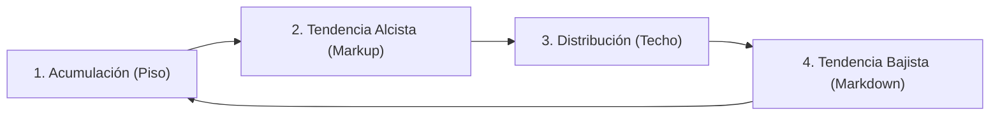
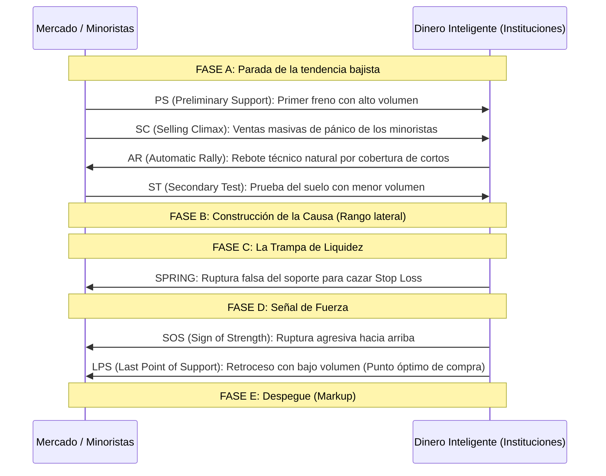
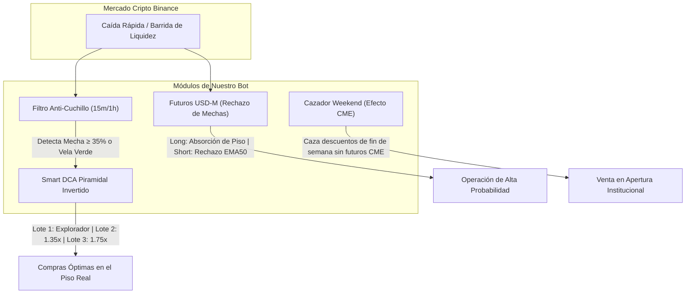

# 🏛️ Guía Maestra de Trading Institucional: Wyckoff, Smart Money Concepts (SMC), Price Action & VSA

> **Documento de Investigación & Estudio Cuantitativo**  
> Diseñado para ingesta y análisis en **Google NotebookLM**, formación de traders algorítmicos y manuales, y calibración de sistemas de alta probabilidad.

---

## 📑 Tabla de Contenidos
1. [Prólogo: La Falacia del Análisis Técnico Minorista](#1-prólogo-la-falacia-del-análisis-técnico-minorista)
2. [Módulo I: Metodología Wyckoff (La Anatomía de las Ballenas)](#2-módulo-i-metodología-wyckoff-la-anatomía-de-las-ballenas)
   - Las 3 Leyes Fundamentales
   - El Esquema de Acumulación
   - El Esquema de Distribución
3. [Módulo II: Smart Money Concepts (SMC) & Liquidez Moderna](#3-módulo-ii-smart-money-concepts-smc--liquidez-moderna)
   - Estructura de Mercado: BOS vs CHoCH
   - Order Blocks (OB) & Zonas de Oferta/Demanda
   - Fair Value Gaps (FVG) & Desequilibrios (Imbalances)
   - Inducement (Inducción) & Caza de Liquidez (BSL / SSL)
4. [Módulo III: Price Action & Volume Spread Analysis (VSA)](#4-módulo-iii-price-action--volume-spread-analysis-vsa)
   - La anatomía de la vela: Mechas de absorción institucional
   - Ley de Esfuerzo vs. Resultado con Volumen
   - Velas Heikin-Ashi: Eliminación del ruido visual
5. [Módulo IV: Correlación con Nuestro Bot de Trading (`binance-spot-bot`)](#5-módulo-iv-correlación-con-nuestro-bot-de-trading-binance-spot-bot)
   - Cómo implementamos Wyckoff y SMC en código
   - El Blindaje de Cero Ventas a Pérdida y el Punto de Invalidez
6. [Módulo V: Mejoras Prácticas para Tomar en Cuenta](#6-módulo-v-mejoras-prácticas-para-tomar-en-cuenta)
7. [Glosario de Términos Institucionales](#7-glosario-de-términos-institucionales)

---

## 1. Prólogo: La Falacia del Análisis Técnico Minorista

El 90% de los traders minoristas pierde su capital durante los primeros 90 días de operativa. La causa primordial no es la falta de disciplina, sino el **marco conceptual erróneo** que utilizan:

| Paradigma Minorista (Retail) | Paradigma Institucional (Smart Money / Wyckoff) |
| :--- | :--- |
| Basado en **indicadores rezagados** (RSI, MACD, Bandas de Bollinger). | Basado en **liquidez, órdenes institucionales y subasta de precios**. |
| Compra en soportes y vende en resistencias clásicas. | Usa los soportes y resistencias como **piscinas de liquidez para cazar stops**. |
| Supone que el mercado se mueve al azar o por noticias públicas. | Entiende que el mercado es manipulado para acumular barato y distribuir caro. |
| Busca "patrones mágicos" de figuras geométricas (hombro-cabeza-hombro). | Rastrea la **causa y el efecto** mediante volumen e intención institucional. |

> [!IMPORTANT]
> Un indicador matemático convencional solo procesa el pasado histórico del precio. No conoce dónde están colocadas las órdenes límite de los creadores de mercado (*Market Makers*). Wyckoff y SMC estudian **dónde reside el dinero real**.

---

## 2. Módulo I: Metodología Wyckoff (La Anatomía de las Ballenas)

Desarrollada por Richard D. Wyckoff a principios del siglo XX, esta metodología modela la operativa de los grandes operadores institucionales ("Composite Operator" o Dinero Inteligente).



### Las 3 Leyes Fundamentales de Wyckoff

1. **Ley de la Oferta y la Demanda:**
   - $\text{Demanda} > \text{Oferta} \implies \text{El precio sube}$.
   - $\text{Oferta} > \text{Demanda} \implies \text{El precio cae}$.
   - $\text{Oferta} \approx \text{Demanda} \implies \text{Consolidación lateral / Rango}$.
2. **Ley de Causa y Efecto:**
   - Para que exista un gran movimiento de precio (*Efecto*), primero debe existir una fase prolongada de preparación previa (*Causa*). Una acumulación que dura semanas producirá una subida explosiva; una consolidación de 10 minutos producirá un recorrido corto.
3. **Ley de Esfuerzo vs. Resultado:**
   - El **esfuerzo** es el **volumen** negociado; el **resultado** es el **desplazamiento del precio** (recorrido de la vela).
   - *Divergencia bajista:* Gran volumen pero la vela apenas avanza y deja mecha superior. Significa que las instituciones están absorbiendo las compras y frenando el precio.

---

### El Esquema Clásico de Acumulación

La acumulación es el proceso por el cual los grandes fondos compran grandes cantidades de un activo a precios de descuento sin disparar el precio prematuramente.



#### Eventos Clave en la Acumulación:
* **Selling Climax (SC):** El punto de máxima desesperación minorista donde las manos débiles capitulan y venden a pérdida. Las ballenas compran todo.
* **Spring (El Muelle / Caza de Stops):** El precio perfora momentáneamente el soporte del rango. Parece que se va al abismo, pero rápidamente es recuperado cerrando con una gran mecha inferior. **Es la señal de compra más poderosa de la metodología.**
* **LPS (Last Point of Support):** La última oportunidad de entrada institucional con riesgo mínimo.

---

## 3. Módulo II: Smart Money Concepts (SMC) & Liquidez Moderna

SMC es la evolución algorítmica de Wyckoff adaptada al trading de alta frecuencia y a los mercados cripto y forex actuales.

### 1. Estructura de Mercado: BOS vs. CHoCH

* **BOS (Break of Structure):** Confirmación de que la tendencia actual continúa. Ocurre cuando el precio supera con cuerpo de vela el último máximo más alto (*Higher High*) en tendencia alcista.
* **CHoCH (Change of Character):** La primera señal de alerta temprana de que la tendencia está por revertir. Ocurre cuando el precio rompe el último mínimo estructural válido (*Higher Low*).

```
Tendencia Alcista:
       [HH]             [HH]  <-- BOS (Continuación)
      /    \           /    \
     /      \         /      \
   [HL]      \       /        \
              \     /          \
               [HL]             \
                                 [CHoCH] <-- Ruptura del último mínimo (Alerta de giro)
```

### 2. Order Blocks (OB) - Bloques de Órdenes

Un **Order Block** es la última vela opuesta antes de un movimiento impulsivo institucional que rompió estructura:
* **Bullish Order Block (Bloque Alcista):** La última vela bajista antes de una fuerte subida que causó un BOS.
* **Mecánica:** Los bancos dejaron órdenes pendientes sin mitigar en esa zona. Cuando el precio regrese a testear ese bloque, rebotará con violencia.

### 3. Fair Value Gaps (FVG) / Desequilibrios (Imbalances)

Ocurre cuando una vela de volumen masivo se mueve tan rápido que no permite que compradores y vendedores negocien en todos los niveles de precio.
* **Estructura FVG Alcista:** El espacio vacío entre el máximo de la Vela 1 y el mínimo de la Vela 3.
* **Regla:** El algoritmo de entrega de precios (*IPDA*) tarde o temprano regresará a llenar ese vacío del 50% al 100% para rebalancear la liquidez antes de continuar su camino.

### 4. BSL y SSL (Piscinas de Liquidez)

El dinero inteligente necesita contrapartes para ejecutar órdenes gigantescas:
* **BSL (Buy-Side Liquidity):** Piscinas de compras situadas por encima de dobles techos (*Equal Highs*). Son los *Stop Loss* de los vendedores en corto. Las instituciones empujan el precio arriba para activarlos y poder meter sus ventas masivas (*Shorts*).
* **SSL (Sell-Side Liquidity):** Piscinas de ventas situadas por debajo de dobles suelos (*Equal Lows*). Las instituciones tiran el precio para activar los *Stop Loss* minoristas y comprar barato.

---

## 4. Módulo III: Price Action & Volume Spread Analysis (VSA)

### La Anatomía de la Vela y las Mechas de Rechazo

En lugar de memorizar 50 nombres de velas japonesas, el trader institucional analiza **presión y absorción**:

$$\text{Ratio de Mecha Inferior} = \frac{\min(\text{Open}, \text{Close}) - \text{Low}}{\text{High} - \text{Low}} \times 100$$

* Si el ratio de mecha inferior supera el **$35\%$ a $50\%$**: Hubo una inyección agresiva de órdenes de compra que absorbió toda la oferta flotante en los mínimos de la vela.
* Si ocurre en soporte o tras caída fuerte: **Confirmación institucional de absorción.**

### Esfuerzo vs. Resultado en el Volumen

```
Caso A: Vela grande verde + Volumen gigante  ==> Movimiento sano (Armonía)
Caso B: Vela pequeña verde + Volumen gigante ==> Absorción oculta de ventas (Divergencia/Trampa)
Caso C: Caída con volumen decreciente (seco) ==> La presión vendedora se agotó (Giro inminente)
```

### Velas Heikin-Ashi: El Filtro del Ruido
A diferencia de las velas japonesas estándar (que calculan solo el precio del tick actual), Heikin-Ashi promedia los datos con la vela previa:
$$\text{Close}_{\text{HA}} = \frac{\text{Open} + \text{High} + \text{Low} + \text{Close}}{4}$$
* **Utilidad institucional:** Permite ignorar las micro-correcciones de 1 minuto y mantenerse en la tendencia hasta que aparezca una vela de indecisión (pequeño cuerpo con mechas a ambos lados).

---

## 5. Módulo IV: Correlación con Nuestro Bot de Trading (`binance-spot-bot`)

La arquitectura de nuestro bot no es una caja negra de indicadores arbitrarios; fue diseñada bajo estos mismos principios cuantitativos e institucionales:



### 1. El Filtro Anti-Cuchillo es el "Spring" de Wyckoff
* **Error común minorista:** Entrar al mercado mientras la vela cae en picada (intentar atrapar un cuchillo cayendo).
* **Nuestra regla de código:** El bot exige que la vela de 15 minutos cierre con una **mecha de absorción inferior $\ge 30\%-35\%$** o que imprima una vela verde de confirmación antes de disparar compras. Esto emula la confirmación del *Spring* o del *LPS* de Wyckoff.

### 2. Smart DCA Piramidal es la "Ley de Causa y Efecto"
* En vez de gastar todo el capital arriba (como hacen los minoristas que quedan atrapados en precios altos), el bot aplica la **Pirámide Invertida**:
  * **Lote 1 (Explorador):** Margen ligero para asegurar presencia si el mercado rebota rápido.
  * **Lote 2 (Soporte $\ge -2.5\%$):** Fuerza **1.35x**.
  * **Lote 3 (Capitulación / Selling Climax $\ge -5.5\%$):** Fuerza **1.75x**.
* **Resultado:** El precio promedio ponderado queda pegado al piso institucional, permitiendo salir en ganancia líquida con un micro-rebote de apenas $+0.8\%$.

### 3. Cazador Weekend y el Ciclo Horario Institucional
* Durante el fin de semana, la bolsa de futuros de Chicago (**CME Group**) cierra. Los creadores de mercado aprovechan la caída de liquidez para liquidar minoristas los sábados.
* El bot detecta esta anomalía y compra en la sobreventa extrema para vender el domingo por la noche cuando los futuros CME abren con su respectivo *gap* o rebote de cobertura.

---

## 6. Módulo V: Mejoras Prácticas para Tomar en Cuenta

A partir de este estudio, podemos extraer 3 mejoras cuantitativas para seguir perfeccionando nuestro bot:

1. **Detección Algorítmica de Fair Value Gaps (FVG) para el Trailing TP:**
   * Actualmente el Trailing Take Profit activa a un porcentaje fijo (ej. $+1.8\%$). Podemos calibrar para que, si el bot detecta un FVG bajista sin mitigar justo arriba, suba el objetivo hasta llenar el $50\%$ de ese desequilibrio institucional antes de activar el callback.
2. **Filtro de Volumen Relativo (RVOL):**
   * Incorporar la métrica $\text{Volumen Actual} / \text{SMA(Volumen, 20)}$. Si una vela rompe soporte pero el RVOL es menor a 1.0 (volumen seco), el bot clasifica automáticamente la ruptura como una **falsa ruptura / trampa de osos** e incrementa la prioridad del Lote Explorador.
3. **Mapeo de Equal Lows (EQL):**
   * Identificar cuando dos velas consecutivas tocan exactamente el mismo precio mínimo centavo a centavo. Ese nivel es un imán de liquidez; el bot debe programar sus órdenes límite ligeramente **por debajo** de ese nivel para comprar después de que las ballenas hayan barrido los stops minoristas.

---

## 7. Glosario de Términos Institucionales

* **Mitigación:** Momento en que el dinero inteligente regresa a una zona de pérdidas pasadas para cerrar posiciones en *breakeven* (empate) y continuar la tendencia dominante.
* **Imbalance / Ineficiencia:** Rango de precio donde solo hubo compradores agresivos o solo vendedores agresivos sin contraparte equilibrada.
* **Sweep (Barrida):** Movimiento rápido que supera un máximo o mínimo por escasos segundos solo para capturar liquidez de *Stop Loss*.
* **Markup / Markdown:** Fases activas de tendencia alcista y bajista generadas tras la acumulación o distribución respectivamente.
* **Smart DCA:** Técnica cuantitativa algorítmica donde cada compra subsecuente actúa como un activo contable independiente con su propio candado de venta en positivo.
