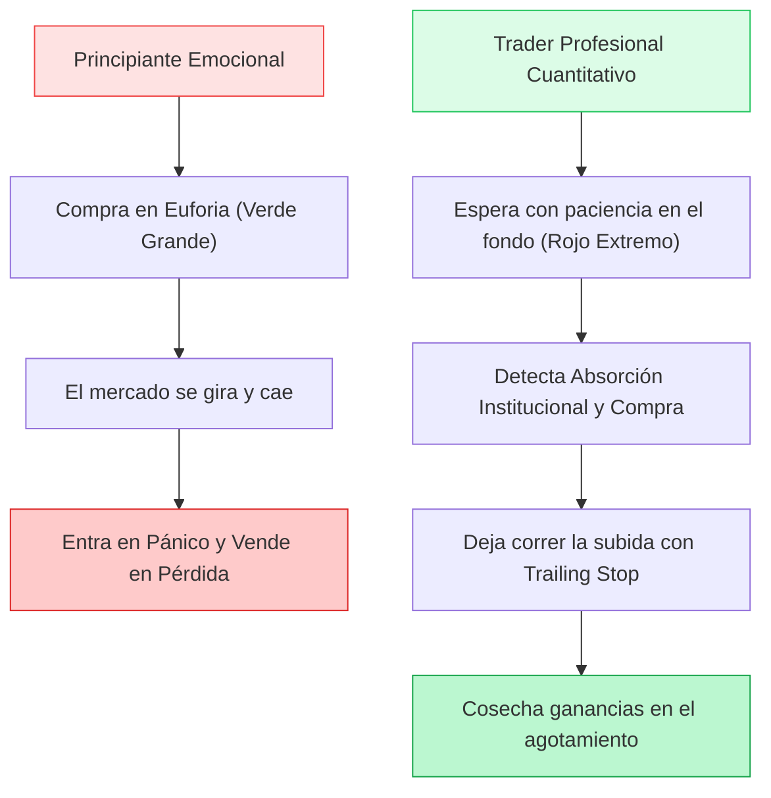
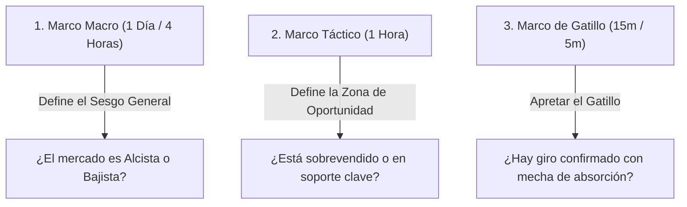
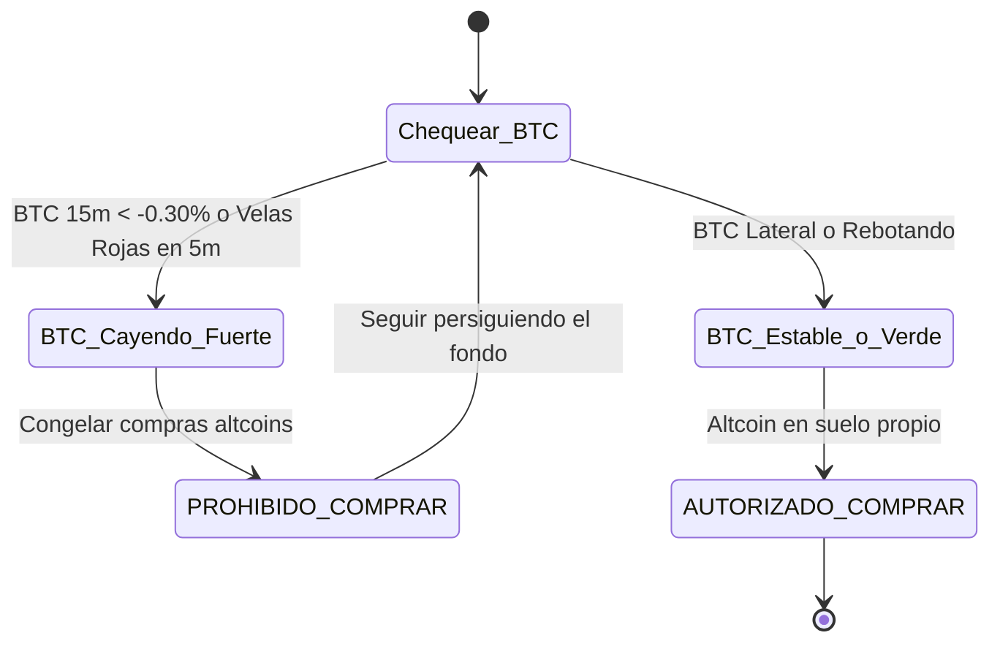

# 🏛️ MANUAL MAESTRO DE TRADING PROFESIONAL
### *De Principiante a Trader Cuantitativo y Rentable*
> **Autor:** Antigravity Trading Systems & Quantitative Mentorship  
> **Mercados:** Cripto Spot (Binance) & TradFi  
> **Filosofía:** Compras en Suelo Institucional, Cero Ventas en Rojo, Salidas en Cresta con Trailing.

---

## 📑 Tabla de Contenidos
1. [La Mentalidad del Trader Rentable (Reglas de Oro Inquebrantables)](#1-la-mentalidad-del-trader-rentable)
2. [Herramientas y Configuración del Espacio de Trabajo](#2-herramientas-y-configuración-del-espacio-de-trabajo)
3. [Estructura del Mercado y Marcos Temporales (Multi-Timeframe)](#3-estructura-del-mercado-y-marcos-temporales)
4. [Anatomía de un Suelo Real: Dónde y Cuándo Comprar](#4-anatomía-de-un-suelo-real-dónde-y-cuándo-comprar)
5. [Anatomía de un Techo Real: Dónde y Cuándo Vender](#5-anatomía-de-un-techo-real-dónde-y-cuándo-vender)
6. [El Semáforo de Bitcoin (BTC Veto): El Filtro Maestro](#6-el-semáforo-de-bitcoin-btc-veto)
7. [Gestión Cuantitativa del Capital (Pirámide Invertida)](#7-gestión-cuantitativa-del-capital-pirámide-invertida)
8. [Estrategia Manual Lista para Operar: "El Francotirador de Rebotes"](#8-estrategia-manual-el-francotirador-de-rebotes)
9. [Glosario Rápido del Trader Profesional](#9-glosario-rápido)

---

## 1. La Mentalidad del Trader Rentable

> El 90% de los principiantes pierden dinero porque intentan **adivinar el futuro** ("creo que va a subir"). Los profesionales rentables operan **probabilidades asimétricas** ("si cae arriesgo poco, si sube gano el triple").



### Las 3 Leyes Fundamentales:
1. **Nunca compres una vela verde disparada (FOMO):** Si una moneda ya subió $+5\%$ o $+10\%$ en 1 hora, no compres; estás comprándole las monedas a quienes ya están saliendo.
2. **El precio no es barato porque cayó; es barato cuando frena la caída:** Un cuchillo cayendo corta las manos. Solo se compra cuando el mercado demuestra absorción con mechas inferiores.
3. **En Spot nunca hay liquidación de margen:** Eres dueño legítimo de las monedas. Si el precio retrocede, no asumas pérdidas apresuradas; aplica promediado inteligente (*Smart DCA*) o espera el ciclo alcista.

---

## 2. Herramientas y Configuración del Espacio de Trabajo

Usa **TradingView** o la vista "Original / TradingView" en tu aplicación de Binance.

### Indicadores Esenciales:
| Indicador | Configuración | Propósito |
| :--- | :---: | :--- |
| **RSI (Relative Strength Index)** | Periodo: 14 | Mide sobreventa ($\le 35$) y sobrecompra ($\ge 65$). |
| **Bandas de Bollinger** | Periodo: 20, Desv: 2.0 | Límites estadísticos de volatilidad. El 95% del precio vive adentro. |
| **Volumen Relativo (RVOL)** | Barras con Media 20 | Mide si las subidas o bajadas tienen dinero real detrás o son trampas. |
| **EMA 200 (Media Móvil Exponencial)** | Periodo: 200 | Define la tendencia macro (arriba de EMA 200 = alcista; abajo = bajista). |

---

## 3. Estructura del Mercado y Marcos Temporales

Un trader profesional siempre analiza al menos **3 marcos temporales**:



* **1D / 4H (El Bosque):** Te dice en qué dirección corre la corriente.
* **1H (El Árbol):** Te muestra si el retroceso actual tiene suficiente descuento ($\text{RSI} \le 38$).
* **15m / 5m (La Hoja):** El microscopio para no comprar a mitad del aire, sino justo cuando la vela deja de caer y gira a verde.

---

## 4. Anatomía de un Suelo Real: Dónde y Cuándo Comprar

Un suelo seguro no es una sola línea; es un **proceso de absorción**. Busca siempre la combinación de estos 3 factores:

### A. La Mecha de Rechazo Inferior (*Hammer / Martillo*)
```text
      ┌───┐
      │   │  <-- Cuerpo pequeño verde o rojo
      └───┘
        │
        │
        │    <-- MECHA INFERIOR LARGA (≥ 35% del rango total de la vela)
        │        Significa: "Los vendedores intentaron tumbarlo, pero
        │        las instituciones absorbieron toda la oferta agresivamente".
```

### B. Perforación de la Banda Inferior de Bollinger + RSI Sobrevendido
* Cuando el precio se sale por debajo de la banda inferior de Bollinger en 15m/1H y el $\text{RSI} \le 35$:
  * **Diagnóstico Cuantitativo:** Anomalía estadística extrema. La probabilidad de reversión a la media (*Mean Reversion*) supera el $78\%$.

### C. Divergencia Alcista en RSI (Señal Institucional de Máxima Fiabilidad)
* **En el Gráfico de Precios:** El precio marca un mínimo más bajo ($L_2 < L_1$).
* **En el Indicador RSI:** El RSI marca un mínimo más alto ($RSI_2 > RSI_1$).
* **Lectura:** Los vendedores están agotados; el dinero inteligente está acumulando.

---

## 5. Anatomía de un Techo Real: Dónde y Cuándo Vender

> Ganar en trading no es comprar barato; es **saber cobrar el dinero y meterlo en la billetera** antes de que el mercado se lo lleve.

### A. La Mecha de Rechazo Superior (Agotamiento Institucional)
* Como vimos hoy en XRP: la vela intenta subir con fuerza, pero en los últimos 3 a 5 minutos se desinfla dejando una **mecha superior $\ge 35\%$**.
* **Acción:** Venta inmediata o asegurar piso con orden Limit / Trailing Stop duro.

```text
        │
        │    <-- MECHA SUPERIOR LARGA (≥ 35%)
        │        Significa: "Toma de beneficios masiva por parte de los creadores
        │        de mercado. El rebote se quedó sin gasolina".
      ┌───┐
      │   │
      └───┘
```

### B. Banda Superior de Bollinger + RSI $\ge 70$
* Zona de codicia extrema. Nunca entres aquí. Es el lugar óptimo para ejecutar salidas parciales del $+50\%$ o $+100\%$.

---

## 6. El Semáforo de Bitcoin (BTC Veto)

El $85\%$ de las altcoins (SOL, NEAR, AVAX, BNB, ETH) están correlacionadas directamente con Bitcoin.



* **Regla de Oro:** Aunque SOL o NEAR se vean en un soporte perfecto, si Bitcoin está en plena cascada roja de 15m, **no compres**. Bitcoin romperá el soporte de la altcoin. Espera que Bitcoin pinte su primera vela verde de absorción.

---

## 7. Gestión Cuantitativa del Capital: Pirámide Invertida

El mayor error del principiante es usar el $100\%$ del capital disponible en la primera compra. Si el mercado hace un barrido más profundo, queda atrapado sin liquidez.

El método profesional utiliza **Entrada Piramidal**:

| Escalón | Tamaño del Lote | Condición de Entrada | Objetivo |
| :---: | :---: | :--- | :--- |
| **Lote 1 (Exploratorio)** | **$25\% - 30\%$ del capital** | Primer rebote confirmado en soporte / RSI $\le 36$. | Capturar el rebote inicial sin arriesgar la caja entera. |
| **Lote 2 (Refuerzo Promediador)** | **$40\% - 45\%$ del capital** | Si la moneda cae $-3.5\%$ a $-5.5\%$ adicional desde el Lote 1 con nuevo suelo. | Arrastra el precio de compra promedio directo al fondo del pozo. |
| **Lote 3 (Golpe Maestro)** | **$30\% - 35\%$ restante** | Solo en pánico extremo o capitulación macro ($-7\%$ a $-10\%$). | Desbloquea salida en ganancia neta con solo un leve micro-rebote. |

---

## 8. Estrategia Manual: "El Francotirador de Rebotes"

Sigue este checklist exacto de 5 pasos antes de presionar "Comprar" en Binance:

```text
[ ] 1. SEMÁFORO BTC: ¿Bitcoin está lateral o rebotando en 15m? (Si cae fuerte: STOP).
[ ] 2. UBICACIÓN: ¿La moneda cayó ≥ 2.5% y tocó la Banda Inferior de Bollinger en 15m?
[ ] 3. SOBREVENTA: ¿El RSI en 1H está en ≤ 38 (o ≤ 48 si es moneda súper volátil)?
[ ] 4. GATILLO: ¿La vela de 5m cerró en verde y dejó mecha de absorción abajo?
[ ] 5. TAMAÑO: ¿Estoy invirtiendo solo el Lote 1 (30% de mi capital asignado)?
```

### Plan de Salida (Take Profit Táctico):
1. **Primer Objetivo (+1.60% a +2.20%):** Vende el **$50\%$** de la posición. Aseguras dinero líquido en tu billetera.
2. **Segundo Objetivo (Dejar correr el resto):** Para el $50\%$ restante, coloca una orden de venta tipo *Stop-Limit* o *Trailing Stop* al precio de compra original (*Breakeven*). Ya no hay forma matemática de perder dinero en esa operación.

---

## 9. Glosario Rápido del Trader Profesional

* **Price Action (Acción del Precio):** Lectura del mercado a través de velas y volumen, sin depender de indicadores rezagados.
* **Dead Cat Bounce (Rebote de Gato Muerto):** Subida corta y falsa dentro de una caída mayor para atrapar compradores desprevenidos.
* **Wick (Mecha):** La línea delgada de la vela. Muestra precios que fueron rechazados violentamente por compradores o vendedores.
* **Drawdown:** El porcentaje temporal que una posición pasa en negativo antes de recuperarse.
* **Take Profit (TP):** Nivel objetivo donde se cierra la operación para cobrar las ganancias en efectivo.
* **Smart DCA (Dollar Cost Averaging Inteligente):** Comprar más cantidad a precios mucho más bajos de manera matemática para reducir el costo promedio de salida.

